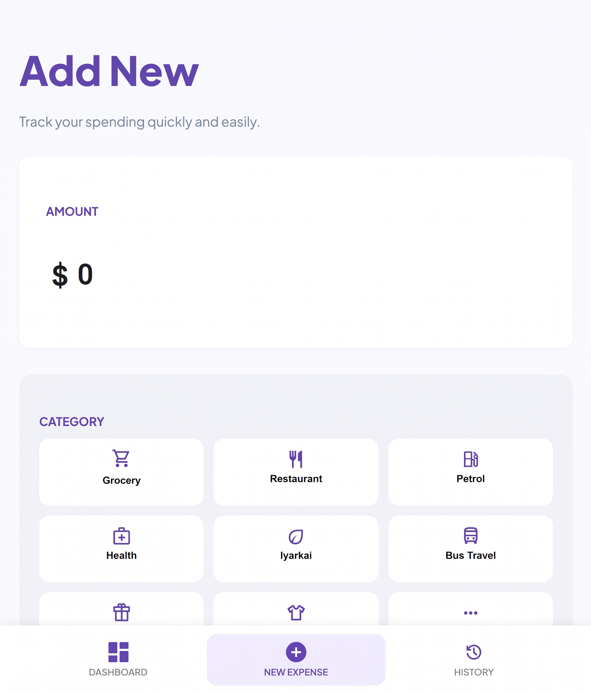
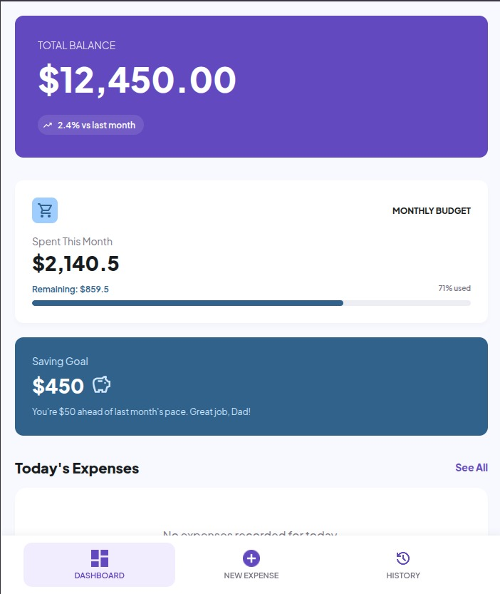
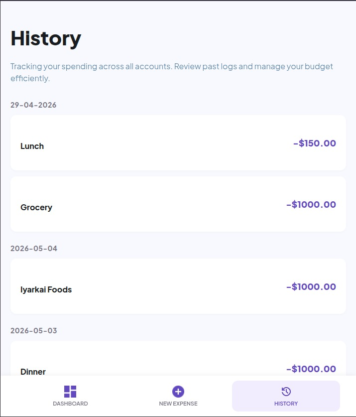
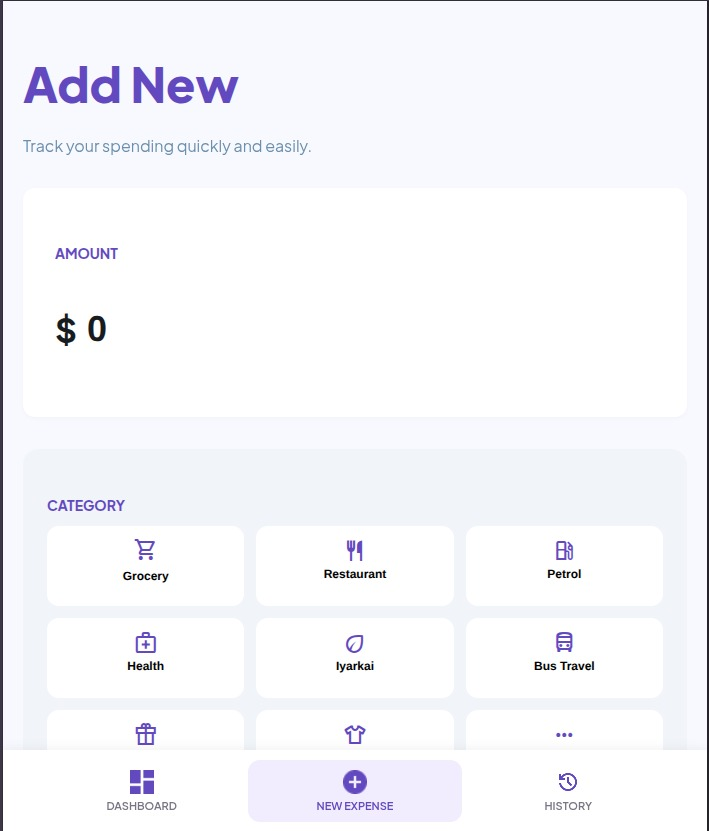

<div align="center">

# 💰 Expense Tracker — Spring Boot REST API & Personal Finance Platform

**An enterprise-grade, full-stack personal finance application engineered with Java 21, Spring Boot, Spring Security, MySQL, and a modern reactive Svelte 5 frontend.**

[](https://www.oracle.com/java/)
[](https://spring.io/projects/spring-boot)
[](https://spring.io/projects/spring-security)
[](https://spring.io/projects/spring-data-jpa)
[](https://www.mysql.com/)
[](https://www.docker.com/)
[-FF3E00.svg?style=flat-square&logo=svelte&logoColor=white)](https://svelte.dev/)
[](https://www.typescriptlang.org/)
[](LICENSE)

[Executive Overview](#-executive-overview) • [Backend Architecture Highlights](#-backend-engineering-highlights) • [System Architecture](#-system-architecture--data-flow) • [Tech Stack](#-tech-stack) • [API Contract](#-api-contract) • [Database Schema](#-database-schema) • [Getting Started](#-getting-started) • [UI Showcase](#-ui-showcase)

</div>

---

## 📌 Executive Overview

**Expense Tracker** is a production-ready, full-stack personal finance and budget tracking system. It empowers users to monitor daily spending, calculate real-time budgetary headroom, manage categorized transaction histories, and achieve long-term savings goals.

The core of the system is built around a robust **Java 21 & Spring Boot** backend architected for enterprise security and high reliability: **stateless JWT-based authentication**, **Spring Security filter chains**, **BCrypt password hashing**, **relational schema design with Spring Data JPA & Hibernate**, **database-level SQL aggregations**, and **Docker containerization**, paired with a responsive client built with **Svelte 5 (Runes)** and **TypeScript**.

---

## 🎯 Backend Engineering Highlights

_Key architectural patterns and engineering decisions relevant for technical recruiters and hiring managers:_

### 1. Robust Security Architecture (Spring Security & JWT)
- **Stateless Session Management:** Configured `SessionCreationPolicy.STATELESS` in Spring Security to eliminate server-side session bloat and enable horizontal scaling.
- **Custom JWT Filter Chain:** Implemented `JwtAuthenticationFilter` positioned before `UsernamePasswordAuthenticationFilter` to intercept requests, validate cryptographic signatures, extract claims, and populate the `SecurityContextHolder`.
- **Defense in Depth with HttpOnly Cookies:** JWT tokens are transmitted via `HttpOnly`, `SameSite=Lax` cookies, neutralizing Cross-Site Scripting (XSS) and Cross-Site Request Forgery (CSRF) vulnerabilities.
- **Strict Data Isolation:** Controller endpoints dynamically resolve the authenticated user ID from the `SecurityContext`, guaranteeing zero cross-tenant data leakage across all CRUD operations.
- **Custom Error EntryPoint:** Implemented a custom `AuthenticationEntryPoint` providing consistent JSON-formatted 401 Unauthorized responses.

### 2. Relational Persistence & Query Optimization (Spring Data JPA + MySQL)
- **Entity Relationships:** Clean `@ManyToOne(fetch = FetchType.LAZY)` relationship mapping between `User` and `Expense` entities preventing unnecessary N+1 queries.
- **Optimized Native SQL Aggregations:** Offloaded computation from the application layer to MySQL using native SQL queries (e.g., current month total spending via `COALESCE(SUM(price), 0)` filtered by month, year, and user ID).
- **Derived Query Methods:** Utilized Spring Data JPA derived query syntax (e.g., `findAllByUserIdOrderByDateDesc`, `findByDateAndUserId`) for clean, type-safe data access without boilerplate code.

### 3. Clean Layered Architecture
- **Controller Layer (`controller/`):** REST endpoints (`AuthController`, `ExpenseController`) following standard HTTP semantics (`GET`, `POST`, `PUT`, `DELETE`) with `@CrossOrigin` handling.
- **Service Layer (`service/`):** Business logic encapsulation across `AuthService`, `ExpenseService`, and `JwtService` using constructor-based dependency injection.
- **Data Access Layer (`repository/`):** Repositories extending `JpaRepository` for type-safe query abstraction.
- **Data Transfer Objects (`dto/`):** Isolated request/response payloads (`LoginRequest`) to decouple domain entities from API contracts.

### 4. Containerization & Deployment Readiness (Docker)
- Packaged services into lightweight Docker containers for reproducible builds across staging and production.
- Environment-variable configuration support (`DB_URL`, `DB_USERNAME`, `DB_PASSWORD`, `JWT_SECRET`) adhering to Twelve-Factor App methodologies.

---

## 🏗️ System Architecture & Data Flow

<<<<<<< HEAD
|                  Dashboard Overview                   |         Transaction History & Management          |
| :---------------------------------------------------: | :-----------------------------------------------: |
|  |  |

|                     Add Expense Form                      | 
| :-------------------------------------------------------: | 
|  | 
=======
```
┌────────────────────────────────────────────────────────────────────────┐
│                        Client Layer (Frontend)                         │
│                  Svelte 5 (Runes) • SvelteKit 2 • Vite                 │
│  - Reactive Dashboard, Date-Grouped History, Modals, Auth Forms        │
│  - Centralized apiFetch Client with automated 401 interceptor          │
└───────────────────────────────────┬────────────────────────────────────┘
                                    │ HTTP / REST (JSON + HttpOnly Cookies)
                                    ▼
┌────────────────────────────────────────────────────────────────────────┐
│                    Backend REST API (Spring Boot 4)                    │
│                                                                        │
│   ┌────────────────────────────────────────────────────────────────┐   │
│   │                 Spring Security Filter Chain                   │   │
│   │  • JwtAuthenticationFilter (Signature verify, Claims extract)  │   │
│   │  • BCryptPasswordEncoder (Salted password hashing)             │   │
│   │  • Stateless Session Policy (SessionCreationPolicy.STATELESS)  │   │
│   │  • Custom AuthenticationEntryPoint (401 JSON error responses)  │   │
│   │  • CORS Configuration Source (Origin & Preflight validation)   │   │
│   └───────────────────────────────┬────────────────────────────────┘   │
│                                   │                                    │
│                                   ▼                                    │
│   ┌────────────────────────────────────────────────────────────────┐   │
│   │                     REST Controller Layer                      │   │
│   │  • AuthController (/auth/login, /auth/signup)                  │   │
│   │  • ExpenseController (/home, /history, /addExpense, /update)   │   │
│   └───────────────────────────────┬────────────────────────────────┘   │
│                                   │                                    │
│                                   ▼                                    │
│   ┌────────────────────────────────────────────────────────────────┐   │
│   │                     Service & Business Logic                   │   │
│   │  • AuthServiceImpl (Token generation, authentication)          │   │
│   │  • ExpenseServiceImpl (CRUD logic, budget calculation)         │   │
│   │  • JwtService (Token generation, validation, expiration)       │   │
│   └───────────────────────────────┬────────────────────────────────┘   │
│                                   │                                    │
│                                   ▼                                    │
│   ┌────────────────────────────────────────────────────────────────┐   │
│   │               Spring Data JPA & Hibernate ORM                  │   │
│   │  • AuthRepository (findByEmail query)                          │   │
│   │  • ExpenseRepository (Native aggregations & chronological order│   │
│   └───────────────────────────────┬────────────────────────────────┘   │
└───────────────────────────────────┼────────────────────────────────────┘
                                    │ JDBC Connection Pool
                                    ▼
┌────────────────────────────────────────────────────────────────────────┐
│                        MySQL Relational Database                       │
│    Tables: `users` (id, name, email, password)                         │
│            `expense` (id, name, price, category, date, user_id [FK])   │
└────────────────────────────────────────────────────────────────────────┘
```
>>>>>>> a944e20 (docs: restructure README to emphasize Spring Boot and backend architecture)

---

## 🛠️ Tech Stack

### Backend & Database
| Technology | Version | Purpose |
| :--- | :--- | :--- |
| **Java** | 21 (LTS) | Core programming language leveraging modern syntax and virtual threads |
| **Spring Boot** | 4.x / 3.x | Standalone microservice framework & dependency injection |
| **Spring Security** | 6.x | Robust authorization, authentication filter chain & CORS management |
| **Spring Data JPA** | 3.x | Object-Relational Mapping (Hibernate) & Repository pattern abstraction |
| **MySQL** | 8.x | Relational database for persistent user and financial data |
| **JJWT (io.jsonwebtoken)** | 0.12.6 | Stateless JSON Web Token generation, claims parsing, and signing |
| **Maven** | 3.9+ | Build automation, dependency management, and compilation |
| **Docker** | Latest | Containerization for consistent, isolated deployments |

### Frontend Client
| Technology | Version | Purpose |
| :--- | :--- | :--- |
| **Svelte 5** | 5.x | Fine-grained reactivity using the new Runes API (`$state`, `$derived`, `$props`) |
| **SvelteKit** | 2.x | File-based routing, server integration, and layout orchestration |
| **TypeScript** | 5.x | Strict type safety for domain models and API responses |
| **Vite** | 7.x | High-speed frontend development server and production bundler |
| **CSS3** | Modern | Fully responsive UI with custom styling (Flexbox, CSS Grid) |

---

## 🔌 API Contract

All secure endpoints require a valid JWT passed via `HttpOnly` cookie or authorization header.

### 🔐 Authentication (`/auth`)
| Method | Endpoint | Description | Request Body / Params |
| :--- | :--- | :--- | :--- |
| `POST` | `/auth/signup` | Register a new user | `{ "name": "...", "email": "...", "password": "..." }` |
| `POST` | `/auth/login` | Authenticate & set `HttpOnly` JWT cookie | `{ "email": "...", "password": "..." }` |

### 💳 Expense Operations (`/`)
| Method | Endpoint | Description | Auth Required |
| :--- | :--- | :--- | :---: |
| `GET` | `/home` | Fetch expenses logged for the current day | Yes |
| `GET` | `/history` | Fetch all historical transactions ordered by date descending | Yes |
| `GET` | `/getSpending` | Retrieve current month's aggregated spending sum | Yes |
| `POST` | `/addExpense` | Create an expense entry for authenticated user | Yes |
| `PUT` | `/update/{id}` | Update an existing expense record by ID | Yes |
| `DELETE` | `/deleteExpense?id={id}`| Remove an expense record by ID | Yes |

---

## 🗄️ Database Schema

The database leverages relational modeling with referential integrity:

```sql
-- Users Table
CREATE TABLE users (
    id INT AUTO_INCREMENT PRIMARY KEY,
    name VARCHAR(255) NOT NULL,
    email VARCHAR(255) UNIQUE NOT NULL,
    password VARCHAR(255) NOT NULL
);

-- Expenses Table
CREATE TABLE expense (
    id INT AUTO_INCREMENT PRIMARY KEY,
    name VARCHAR(255) NOT NULL,
    price INT NOT NULL,
    category VARCHAR(100) NOT NULL,
    description TEXT,
    date DATE NOT NULL,
    user_id INT NOT NULL,
    CONSTRAINT fk_expense_user FOREIGN KEY (user_id) REFERENCES users(id) ON DELETE CASCADE
);
```

---

## 📂 Project Directory Structure

```text
ExpenseTracker/
├── backend/                                # Spring Boot Java Application
│   ├── src/main/java/com/example/expense_tracker/
│   │   ├── ExpenseTrackerApplication.java  # Application bootstrap entry point
│   │   ├── config/
│   │   │   ├── SecurityConfig.java         # Spring Security filter chain, CORS & hashing
│   │   │   └── JwtAuthenticationFilter.java# Per-request JWT authentication filter
│   │   ├── controller/
│   │   │   ├── AuthController.java         # Login, registration & cookie endpoints
│   │   │   └── ExpenseController.java      # Expense CRUD & analytics endpoints
│   │   ├── dto/
│   │   │   └── LoginRequest.java           # Authentication request DTO
│   │   ├── entity/
│   │   │   ├── User.java                   # User entity with UserDetails implementation
│   │   │   └── Expense.java                # Expense entity with JPA annotations
│   │   ├── repository/
│   │   │   ├── AuthRepository.java         # User persistence queries
│   │   │   └── ExpenseRepository.java      # Custom native queries & derived finders
│   │   └── service/
│   │       ├── AuthService.java            # Auth contract
│   │       ├── AuthServiceImpl.java        # Authentication logic implementation
│   │       ├── ExpenseService.java         # Expense business contract
│   │       ├── ExpenseServiceImpl.java     # Transactional CRUD business logic
│   │       └── JwtService.java             # Cryptographic token operations
│   ├── src/main/resources/
│   │   └── application.properties          # DB credentials & JWT secret properties
│   └── pom.xml                             # Maven build and dependency configuration
│
├── frontend/                               # Svelte 5 / SvelteKit Client
│   ├── src/
│   │   ├── lib/
│   │   │   ├── components/                 # Reusable UI cards, modals, layout
│   │   │   ├── services/                   # apiFetch client & endpoints
│   │   │   └── types/                      # TypeScript domain models
│   │   └── routes/                         # SvelteKit file-based pages
│   ├── Dockerfile                          # Frontend Docker containerization
│   └── package.json                        # Frontend dependencies
│
└── README.md
```

---

## 🚀 Getting Started

### Prerequisites
- **Java 21 (JDK)**
- **Maven 3.9+** (or use bundled `./mvnw`)
- **MySQL 8.x** running locally or in Docker
- **Node.js v18+** & **npm** (for the frontend client)

---

### 1. Set Up the MySQL Database

Create the database in MySQL:

```sql
CREATE DATABASE expense_tracker;
```

---

### 2. Configure & Run the Spring Boot Backend

1. Navigate to the backend directory:
   ```bash
   cd backend
   ```

2. Configure `src/main/resources/application.properties` (or set environment variables):
   ```properties
   spring.datasource.url=${DB_URL:jdbc:mysql://localhost:3306/expense_tracker}
   spring.datasource.username=${DB_USERNAME:root}
   spring.datasource.password=${DB_PASSWORD:yourpassword}
   jwt.secret=${JWT_SECRET:my-super-secret-key-my-super-secret-key-123456}
   ```

3. Build and run the backend using Maven:
   ```bash
   ./mvnw clean spring-boot:run
   ```

The backend server will start on `http://localhost:8080`.

---

### 3. Run the Frontend Client

1. Open a new terminal and navigate to the frontend directory:
   ```bash
   cd frontend
   ```

2. Install dependencies:
   ```bash
   npm install
   ```

3. Start the development server:
   ```bash
   npm run dev
   ```

Navigate to `http://localhost:5173` to interact with the full-stack application.

---

### 🐳 Docker Setup (Frontend Container)

To run the frontend client inside a Docker container:

```bash
cd frontend
docker build -t expense-tracker-frontend .
docker run --rm -p 5050:5050 --name expense-tracker-frontend expense-tracker-frontend
```

---

## 🖼️ UI Showcase

|                  Dashboard Overview                   |         Transaction History & Management          |
| :---------------------------------------------------: | :-----------------------------------------------: |
|  |  |

|                     Add Expense Form                      |               Application Preview                 |
| :-------------------------------------------------------: | :-----------------------------------------------: |
|  |  |

---

## 👤 Author

**Jagatha Devendran**
- GitHub: [@jagatha-devendran](https://github.com/jagatha-devendran)
- Email: [jagathadevam965@gmail.com](mailto:jagathadevam965@gmail.com)

---

## 📄 License

This project is licensed under the [MIT License](LICENSE).
