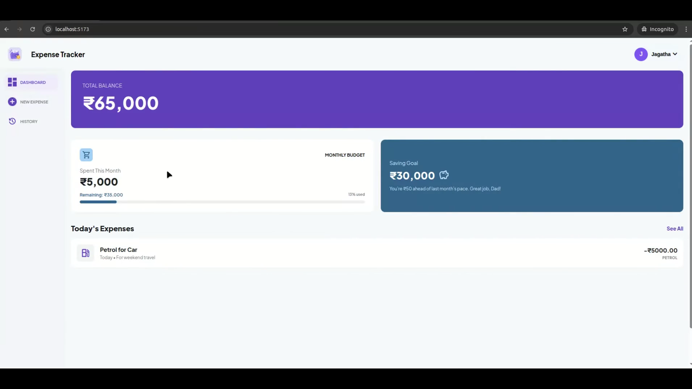
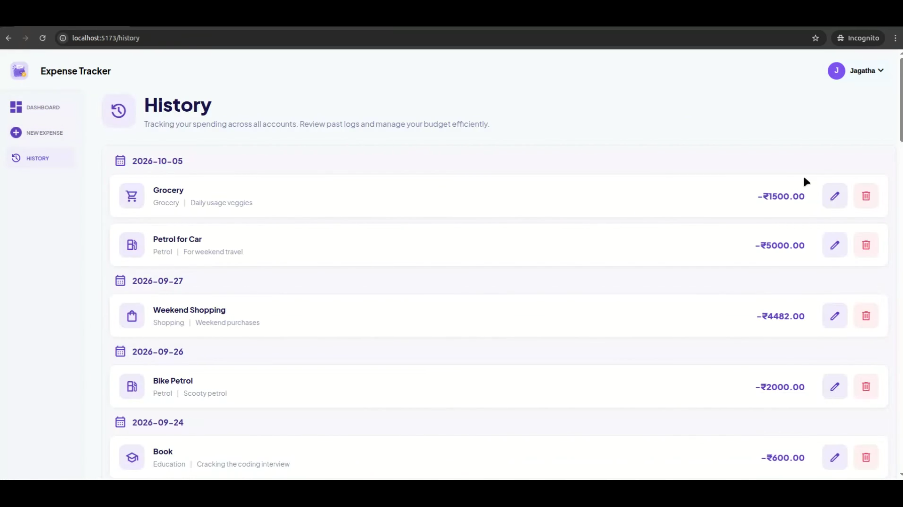
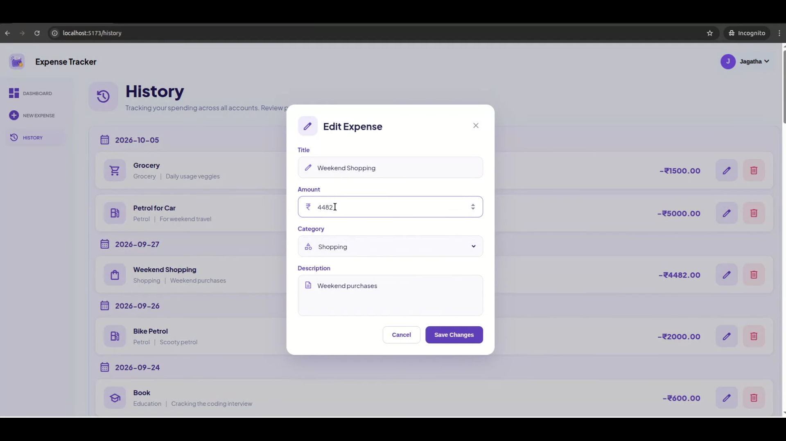
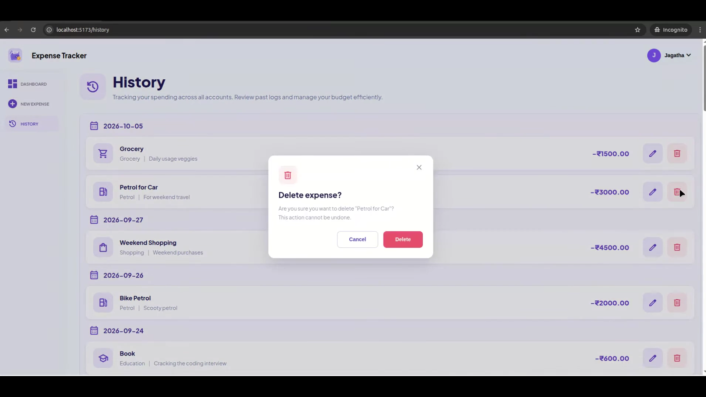
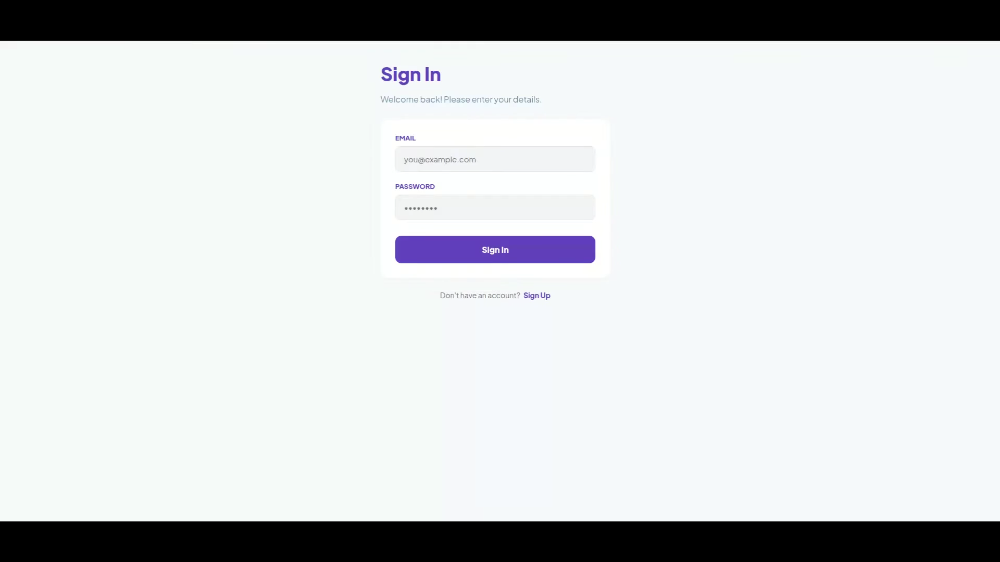
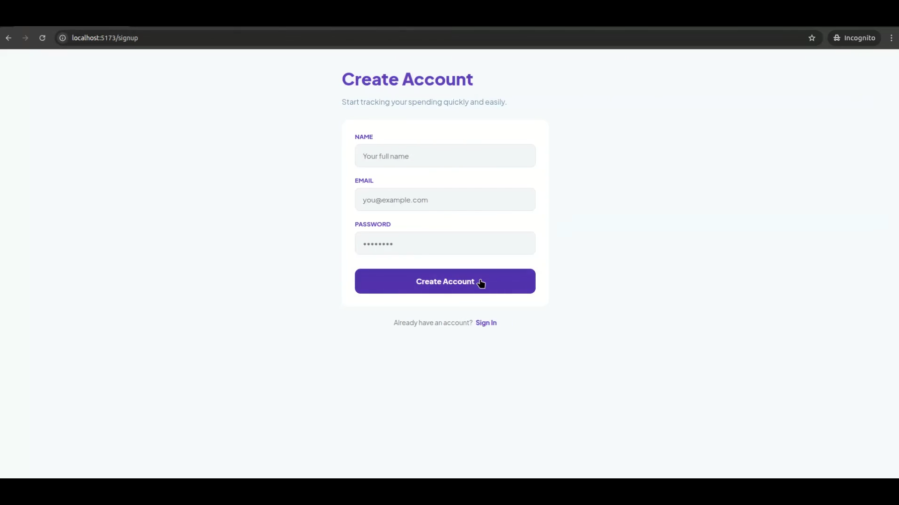
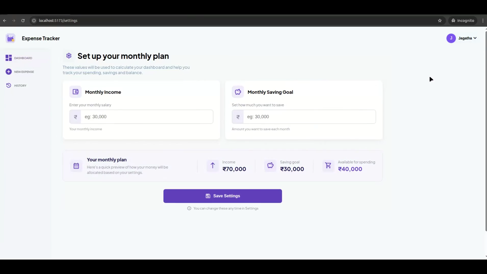
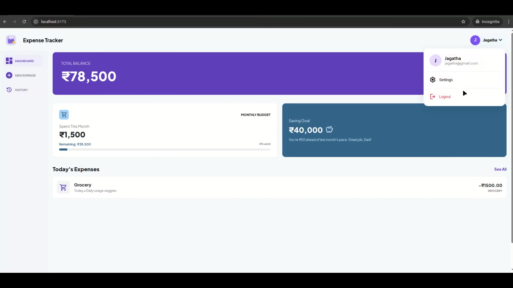

<div align="center">

# 💰 Expense Tracker

**A full-stack personal finance web application built with Spring Boot (Java 21) and Svelte 5.**

[](https://www.oracle.com/java/)
[](https://spring.io/projects/spring-boot)
[](https://spring.io/projects/spring-security)
[](https://spring.io/projects/spring-data-jpa)
[-FF3E00.svg?style=flat-square&logo=svelte&logoColor=white)](https://svelte.dev/)
[](https://www.typescriptlang.org/)
[](https://www.docker.com/)
[](LICENSE)

[Overview](#-overview) • [Backend Architecture](#-backend-architecture) • [System Flow](#-system-architecture) • [Tech Stack](#-tech-stack) • [API Endpoints](#-api-endpoints) • [Screenshots](#-screenshots) • [Getting Started](#-getting-started)

</div>

---

## 📌 Overview

**Expense Tracker** is a full-stack personal finance tool for logging daily spending, tracking monthly budgets, and viewing transaction history.

The backend is built with **Spring Boot** and **MySQL**, providing secure REST endpoints with stateless JWT authentication and user data isolation. The frontend is built with **Svelte 5** and **TypeScript**, using Svelte's Runes system for reactive state management.

---

## 🎯 Backend Architecture

### 1. Authentication & Security
- **Stateless JWT Auth:** User authentication handled via Spring Security with stateless sessions (`SessionCreationPolicy.STATELESS`).
- **Custom JWT Filter:** `JwtAuthenticationFilter` validates tokens and sets the `SecurityContext` for authenticated requests.
- **Secure Cookie Storage:** JWT is issued inside an `HttpOnly`, `SameSite=Lax` cookie to help mitigate XSS and CSRF risks.
- **User Data Isolation:** All expense queries filter by the authenticated user's ID extracted directly from the session.

### 2. Data Persistence (Spring Data JPA + MySQL)
- **Relational Mapping:** `User` and `Expense` entities connected via `@ManyToOne` relationship.
- **Aggregated Queries:** Custom native SQL query in `ExpenseRepository` calculates current-month spending (`COALESCE(SUM(price), 0)`) directly in MySQL.
- **Clean Query Methods:** Spring Data JPA methods like `findAllByUserIdOrderByDateDesc` and `findByDateAndUserId` for fast, date-sorted lookups.

### 3. Layered Design
- **Controller Layer:** `AuthController` and `ExpenseController` handle HTTP routing, request parsing, and response status codes.
- **Service Layer:** `AuthService`, `ExpenseService`, and `JwtService` encapsulate core business logic.
- **Repository Layer:** `AuthRepository` and `ExpenseRepository` handle database interactions.

---

## 🏗️ System Architecture

```
┌────────────────────────────────────────────────────────┐
│                   Frontend (Svelte 5)                  │
│       Dashboard • History • Modals • Settings • Auth    │
│            apiFetch (Cookie credentials + 401 guard)   │
└───────────────────────────┬────────────────────────────┘
                            │ REST / JSON (HTTP)
                            ▼
┌────────────────────────────────────────────────────────┐
│               Spring Boot Backend (Java 21)            │
│                                                        │
│   ┌────────────────────────────────────────────────┐   │
│   │  Spring Security (JWT Filter, BCrypt, CORS)    │   │
│   └───────────────────────┬────────────────────────┘   │
│                           │                            │
│                           ▼                            │
│   ┌────────────────────────────────────────────────┐   │
│   │  Controllers: AuthController, ExpenseController│   │
│   └───────────────────────┬────────────────────────┘   │
│                           │                            │
│                           ▼                            │
│   ┌────────────────────────────────────────────────┐   │
│   │  Services: AuthService, ExpenseService, JWT    │   │
│   └───────────────────────┬────────────────────────┘   │
│                           │                            │
│                           ▼                            │
│   ┌────────────────────────────────────────────────┐   │
│   │  Repositories: AuthRepository, ExpenseRepo     │   │
│   └───────────────────────┬────────────────────────┘   │
└───────────────────────────┼────────────────────────────┘
                            │ JDBC
                            ▼
┌────────────────────────────────────────────────────────┐
│                     MySQL Database                     │
│               tables: users, expense                   │
└────────────────────────────────────────────────────────┘
```

---

## 🛠️ Tech Stack

| Layer | Technology | Description |
| :--- | :--- | :--- |
| **Backend** | Java 21, Spring Boot, Spring Security | REST API, authentication filter, and business logic |
| **Persistence** | Spring Data JPA, Hibernate, MySQL | Relational data persistence and SQL aggregations |
| **Auth** | JJWT (`io.jsonwebtoken`), BCrypt | Token signing, password hashing, HttpOnly cookies |
| **Frontend** | Svelte 5, SvelteKit, TypeScript | Reactive UI with Runes (`$state`, `$derived`, `$props`) |
| **DevOps / Build**| Maven, Vite, Docker | Dependency management, bundling, containerization |

---

## 🔌 API Endpoints

### Authentication (`/auth`)
| Method | Endpoint | Description |
| :--- | :--- | :--- |
| `POST` | `/auth/signup` | Register new user account |
| `POST` | `/auth/login` | Authenticate and set `HttpOnly` JWT cookie |

### Expenses
| Method | Endpoint | Description |
| :--- | :--- | :--- |
| `GET` | `/home` | Fetch current day's expenses for authenticated user |
| `GET` | `/history` | Fetch all expenses sorted by date descending |
| `GET` | `/getSpending` | Get total spending for current month |
| `POST` | `/addExpense` | Add a new expense record |
| `PUT` | `/update/{id}` | Update an existing expense by ID |
| `DELETE` | `/deleteExpense?id={id}` | Delete an expense by ID |

---

## 🖼️ Screenshots

| Home / Dashboard | Transaction History |
| :---: | :---: |
|  |  |

| Edit Expense Modal | Delete Confirmation |
| :---: | :---: |
|  |  |

| Sign In | Sign Up |
| :---: | :---: |
|  |  |

| Settings | Logout |
| :---: | :---: |
|  |  |

---

## 📂 Project Structure

```text
ExpenseTracker/
├── backend/
│   ├── src/main/java/com/example/expense_tracker/
│   │   ├── config/          # SecurityConfig, JwtAuthenticationFilter
│   │   ├── controller/      # AuthController, ExpenseController
│   │   ├── dto/             # LoginRequest
│   │   ├── entity/          # User, Expense
│   │   ├── repository/      # AuthRepository, ExpenseRepository
│   │   └── service/         # AuthService, ExpenseService, JwtService
│   ├── src/main/resources/  # application.properties
│   └── pom.xml
│
├── frontend/
│   ├── src/
│   │   ├── lib/             # Components, services, assets, types
│   │   └── routes/          # SvelteKit route pages
│   ├── Dockerfile
│   └── package.json
│
└── README.md
```

---

## 🚀 Getting Started

### Prerequisites
- Java 21 (JDK) & Maven
- MySQL 8.x
- Node.js (v18+) & npm

---

### 1. Database Setup

Create the database in MySQL:

```sql
CREATE DATABASE expense_tracker;
```

---

### 2. Run the Backend

1. Navigate to the backend directory:
   ```bash
   cd backend
   ```

2. Configure database credentials and secrets in `src/main/resources/application.properties` (or pass via environment variables):
   ```properties
   spring.datasource.url=${DB_URL:jdbc:mysql://localhost:3306/expense_tracker}
   spring.datasource.username=${DB_USERNAME:root}
   spring.datasource.password=${DB_PASSWORD:yourpassword}
   jwt.secret=${JWT_SECRET:your-secret-key}

   # Port can be customized as needed (defaults to 8080)
   # server.port=8080
   ```

3. Start the Spring Boot application:
   ```bash
   ./mvnw clean spring-boot:run
   ```

---

### 3. Run the Frontend

1. Navigate to the frontend directory:
   ```bash
   cd frontend
   ```

2. Install dependencies:
   ```bash
   npm install
   ```

3. Configure your backend URL if different from default in `.env`:
   ```env
   PUBLIC_API_BASE_URL=http://localhost:8080
   ```

4. Start the frontend:
   ```bash
   npm run dev
   ```

*(Default port is `5173`, configurable via Vite `--port` flag)*

---

### 🐳 Docker (Frontend Container)

To build and run the frontend with Docker:

```bash
cd frontend
docker build -t expense-tracker-frontend .
# Map to your preferred host port (e.g. 5050 or any open port)
docker run --rm -p 5050:5050 --name expense-tracker-frontend expense-tracker-frontend
```

---

## 👤 Author

**Jagatha Devendran**
- GitHub: [@jagatha-devendran](https://github.com/jagatha-devendran)
- Email: [jagathadevam965@gmail.com](mailto:jagathadevam965@gmail.com)

---

## 📄 License

This project is open-source and licensed under the [MIT License](LICENSE).
